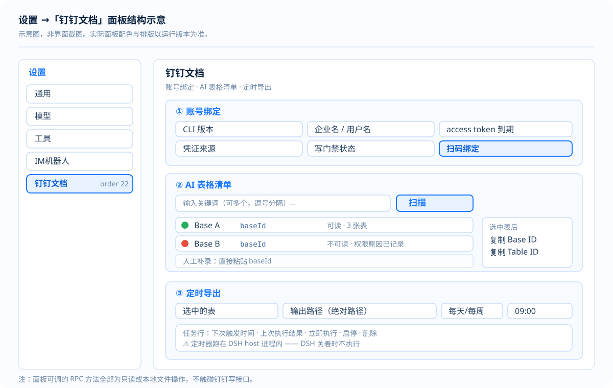

<p align="center">
  
</p>

---

<div align="center">
  <p><strong>让钉钉 AI 表格的数据，流进 DeepSeek Harness</strong></p>
  <p><strong>Read and write DingTalk AI Tables from DeepSeek Harness</strong></p>

  <p>
    <a href="LICENSE"></a>
    = 22.19">
    
    
  </p>

  <p>
    = 1.0.6">
    
    
  </p>

  <p><strong>简体中文</strong> · <a href="README.en.md">English</a></p>
</div>

---

## 简介

一个 DSH 插件，把**钉钉 AI 表格**（多维表 / aitable）接到 DeepSeek Harness 上。装完即得
**10 个 `dingtalk_aitable_*` 工具**和一个**「钉钉文档」设置面板**——在 Harness 里直接发现 Base、
读数据表、按条件查记录、批量写回、导出带 BOM 的中文 CSV，并支持**定时导出**。

**架构**：包装钉钉官方 `dws`（`dingtalk-workspace-cli`）执行 `dws aitable ...`，
**不直连 REST**。这与钉钉官方 OpenClaw connector **同构**——它自己也不直连 REST，
而是注入 `DWS_CLIENT_ID/SECRET` 后调 `dws`（**实测**，2026-09-14 直读其仓库确认）。

**设计取向**：**只读优先 + 写门禁**。写与删除默认全关，删除还需每次逐条确认。
宁可多一步确认，也不给"模型幻觉 + 权限过大"留组合空间。

> **⚠️ 这不是一个自包含插件**——它依赖外部 CLI `dws`。
> 装之前请先读 [安装与前置条件](docs/安装与前置条件.md)，**三层依赖（Node / dws / 钉钉侧授权）缺一不可**。

## 界面



> 上图为**面板结构示意（非截图）**。设置 → 「钉钉文档」（order 22，排在「IM机器人」之后），
> 内含三区：**账号绑定 / AI 表格清单 / 定时导出**。
> 真实截图待补，清单与打码要求见 [docs/images/README.md](docs/images/README.md)。

## 能力一览

| 能力 | 入口 | 写门禁 |
|---|---|---|
| 自检（版本 / 授权 / 命令面 / RPC 端点） | `dingtalk_aitable_diagnose` | — |
| Base 文件：查 / 建 / 改 / 删 | `dingtalk_aitable_base` | 删需双锁 |
| 数据表：查表与字段 / 建 / 改 / 删 | `dingtalk_aitable_table` | 删需双锁 |
| 字段：查 / 建 / 改 / 删 | `dingtalk_aitable_field` | 删需双锁 |
| 记录：按 ID 或条件查（可全量拉） | `dingtalk_aitable_record_query` | 无 |
| 记录：批量写 / 改 / 删 | `dingtalk_aitable_record_write` | 写 / 删门禁 |
| 受控直通（注册表内任意子命令） | `dingtalk_aitable_raw` | 危险命令需双锁 |
| 候选 Base 发现 + **可读性实测** | `dingtalk_aitable_scan` | 无 |
| 全量导出 CSV（**带 BOM**，覆盖同名） | `dingtalk_aitable_export_csv` | 无 |
| 定时导出任务：建 / 列 / 删 / 启停 / 立即执行 | `dingtalk_sync_job` | 无 |

**双锁** = `allowDelete: true`（配置层）+ `confirm: true`（逐次，表示已获同意）。

## 首屏必读三条

> 这三条最容易被误解，先看这里再看细节。

> 1. **定时器跑在 DSH host 进程内**——DSH 关着时不执行，重启后重算下次触发点。**不是**云端定时。
> 2. **钉钉侧没有"列出全部 Base"的接口**——扫描产出是「候选 ∪ 人工补录」，**不保证穷尽**，
>    且 `base search` 的 `hasMore: true` 是**误报**（游标翻页无效）。
> 3. **写与删除门禁默认全关**——删除还需每次 `confirm=true`。

> 本 README 中每条技术结论均标明来源档位：**实测** / **官方原文** / **推测**，并附取得日期。

---

## 一、为什么从"手搓 REST"改成"包装 dws"

| | v0.1 手搓 REST（已废弃） | v0.2+ 包装 dws（当前） |
|---|---|---|
| 端点来源 | 靠推断，标 `pending` | 官方 CLI 内置，已发布可用 |
| 鉴权 | 自己换 accessToken、缓存、刷新 | dws 自动管理（2h 自动刷新） |
| 分页/错误码 | 自己实现 | dws 提供 `--format json` + 恢复闭环 |
| 正确性风险 | 高（路径与请求体都可能错） | 低（命令面有官方文档） |
| 维护成本 | 跟钉钉 API 变更 | 跟 dws 版本 |

**结论**：v0.1 已废弃。改为包装 dws，消除了全部端点不确定性。

同时纠正了 v0.1 的**三处硬错误**（官方文档明确点名）：

1. `sheetId` → 正确是 **`tableId`**（AI 表格的数据模型是 base/table/field/record）
2. 记录写入 `cells` 的 key 必须是 **`fieldId`（fldXXX）**，**不是字段名**
3. 更新记录必须带 **`recordId`**

---

## 二、前置条件（钉钉侧 + 本机侧）

> **完整版见 [docs/安装与前置条件.md](docs/安装与前置条件.md)**（含平台矩阵、解压依赖、组织级拦阻、一键核验清单）。
> 下面是速查版。

**三层依赖，缺一不可**：

| 层 | 要求 |
|---|---|
| ① 本机运行时 | **Node ≥ 22.19**（本插件要求）；DSH `0.1.2-alpha.4` ~ `0.1.5-alpha.1` |
| ② dws CLI | `npm i -g dingtalk-workspace-cli`，**版本 ≥ 1.0.6**（实测基线 `v1.0.61`） |
| ③ 钉钉侧 | 授权 ＋ 开通「AI 表格记录读写」权限 ＋ **把应用加为 Base 协作者（可编辑）★最易漏** |

### 1. 安装 dws（本机）

```sh
npm i -g dingtalk-workspace-cli
dws --version          # 必须 >= 1.0.6，实测基线 v1.0.61
npm root -g            # 记下前缀，Windows 上要用它填 dwsEntry
```

> ⚠️ `dws` **不是纯 JS 包**——它带 `postinstall`，安装时**下载并解压一个平台原生二进制**（约 25 MB）。
> 支持 Windows / macOS / Linux 的 x64 与 arm64 六个平台。
> 解压依赖：Windows 用系统自带 `powershell.exe`，macOS / Linux 需要 `tar` 或 `unzip`。
> 完整矩阵见 [docs/安装与前置条件.md](docs/安装与前置条件.md)。

### 2. 授权（二选一）

**方式 A — 扫码登录（交互式）**
```sh
dws auth login         # 钉钉 App 扫码授权；token 自动刷新（access 2h / refresh 30d）
dws auth status        # 确认已登录
```

**方式 B — 复用钉钉应用凭证（headless / 推荐给服务器）**
```sh
# Windows
set DWS_CLIENT_ID=<你的 Client ID>
set DWS_CLIENT_SECRET=<你的 Client Secret>
# macOS / Linux
export DWS_CLIENT_ID=<你的 Client ID>
export DWS_CLIENT_SECRET=<你的 Client Secret>

dws auth login
```
> 凭证优先级：`--token` > `DWS_CLIENT_ID/SECRET` > OAuth 加密存储。
> 凭证**只走环境变量**注入子进程，不进命令行参数（避免出现在进程列表里）。

### 3. 开通权限（**极易漏，漏了必 403**）

1. **钉钉开发者后台** → 该应用 → 权限管理 → 开通 **AI 表格（多维表）记录读写**权限 → **发布生效**
2. **目标 Base** → 右上角「协作/分享」→ 把该应用加为协作者，权限给到**可编辑**

> 这两件事缺一不可。`dws` 报 `permission denied` / 403 时，九成是这里没做完。

---

## 三、安装插件

```sh
# 从 npm 安装
dsh plugin --profile web add @yiyunet/dsh-dingtalk-connector

# 或从本地路径安装（开发时）
dsh plugin --profile web add "<本仓库绝对路径>"

dsh --profile web --dump-config          # 期望看到 dingtalk-connector 这一层
```
然后重启 `dsh web`。

自带一个引导 CLI：

```sh
npx @yiyunet/dsh-dingtalk-connector install [--profile web]   # 安装 + 核对配置层
npx @yiyunet/dsh-dingtalk-connector doctor                    # 体检：dsh / dws / Node / 授权状态
```

---

## 四、配置（`cordis.patch.yml`）

| 配置项 | 默认 | 说明 |
|---|---|---|
| `dwsCommand` | `dws` | PATH 上的命令名 |
| `dwsEntry` | 无 | **Windows 建议设**：dws 的 JS 入口绝对路径。设了就用 node 直接 spawn，**完全不走 shell**，记录文本里的引号/`&`/`\|` 才安全 |
| `timeoutMs` | 60000 | 单条命令超时 |
| `clientIdEnv` / `clientSecretEnv` | `DWS_CLIENT_ID` / `DWS_CLIENT_SECRET` | 凭证环境变量名 |
| `allowWrite` | **false** | 开关：create / update |
| `allowDelete` | **false** | 开关：delete（独立，且每次还要 `confirm=true`） |
| `maxBatch` | 30 | 单次批量上限（官方 connector skill 规定 ≤30） |
| `exportRoot` | 无 | 可选：把导出落盘**限制**在指定目录内 |
| `defaultExportDir` | 无 | 可选：面板「选表后自动填充」的目录；不设则只填文件名 |
| `scanConcurrency` | 4 | 扫描可读性实测的并发数（防限流） |

### 关于 `dwsEntry`（Windows 上的安全要点）

Windows 上 `.cmd` 必须经 shell 启动，而 shell 会解释参数里的元字符——记录文本含引号或
`&`/`|` 时可能被注入。插件对此**硬拒绝**（返回 `ARG_UNSAFE` 并给出指引）。

要彻底解决：把 `dwsEntry` 指向 dws 的 JS 入口，例如

```yaml
dwsEntry: '<npm root -g>/dingtalk-workspace-cli/bin/dws.js'
```

先用 `npm root -g` 确认你本机的实际前缀（Windows 上分隔符用 `\`）。

---

## 五、十个工具

| 工具 | 作用 | 门禁 |
|---|---|---|
| `dingtalk_aitable_diagnose` | **自检**：dws 版本 / 授权状态 / 已注册命令 | 无 |
| `dingtalk_aitable_base` | Base 文件：list / search / get / create / update / delete | delete 需双锁 |
| `dingtalk_aitable_table` | 数据表：get（**必传 `tableIds` 才返回字段**）/ create / update / delete | delete 需双锁 |
| `dingtalk_aitable_field` | 字段：get / create / update / delete | delete 需双锁 |
| `dingtalk_aitable_record_query` | **读记录**（按 ID 或条件查；`all=true` 可全量拉） | 无 |
| `dingtalk_aitable_record_write` | 写记录：create / update / delete | write / delete 门禁 |
| `dingtalk_aitable_raw` | 受控直通：注册表内任意子命令 | 危险命令需双锁 |
| `dingtalk_aitable_scan` | 候选 Base 发现 + **可读性实测** | 无 |
| `dingtalk_aitable_export_csv` | 全量导出 CSV（**带 BOM**，表头用字段中文名，**覆盖同名**） | 无（受 `exportRoot` 可选约束） |
| `dingtalk_sync_job` | 定时导出任务 create / list / remove / enable / disable / run-now | 无 |

**双锁** = `allowDelete: true`（配置）+ `confirm: true`（逐次，表示已获同意）。

---

## 五之二、设置面板「钉钉文档」

在 **设置** 里出现一级项 **「钉钉文档」**（order 22，排在「IM机器人」之后）。

### 面板做三件事

| 区 | 内容 |
|---|---|
| **账号绑定** | 显示 CLI 版本、企业名 / 用户名、access token 到期、凭证来源、写门禁状态；含扫码绑定会话（二维码 / 深链 / 原始输出 / 组织拦阻提示） |
| **AI 表格清单** | 输入关键词 → 扫描（候选发现 + **可读性实测**）→ 每个 Base 标「可读/不可读」→ 展开看数据表 → 单选一张表 → **复制 Base ID / Table ID** |
| **定时导出** | 选中的表 + 输出路径 + 每天/每周 + 时间 → 新建任务；任务表显示下次/上次结果，支持**立即执行 / 启停 / 删除** |

### 工程形态

`lib/client.js` 是 `npm run build` 的**构建产物**：esbuild 把 `plugin-src/client/impl.mjs`
打成 IIFE，再把手写的装载器 wrapper `plugin-src/client/index.mjs` 接在其后，产出官方客户端模块系统同形的结构：

```js
window.__ModuleLoader__.load({
  id: '@yiyunet/dsh-dingtalk-connector',
  factory: (require) => { /* ... */ return module.exports },   // 契约：{ name, inject, apply }
})
```

- 平台冻结模块表提供 `require('react')`；打包时 `react` / `react-dom` 标记为 external（运行时解析）
- 客户端 → 宿主：`ctx.connection.rpc.call('/api', 'dsh-dingtalk-connector', { method, payload }, signal)`
- 宿主端点：`ctx.connection.fetch.register({ path: '/api/dsh-dingtalk-connector', methods:['POST'], ... })`（见 `plugin-src/host/rpc.mjs`）

### ⚠️ 关键架构约束：`connection` 必须走 **scoped 注入**，绝不能写进 `inject`

`connection` 服务**只存在于 web 平面**（由 `packages/bundle/web-app` 挂载 `@deepseek-ai/dsh-client-connection`）。

如果把它写进本插件的顶层声明 `inject = ['tools', 'connection']`，那么：

> **在 headless / tui 等没有 web 连接的 profile 里，整个插件会永远停在 `inactive`** ——
> 连那 10 个 `dingtalk_aitable_*` 工具会一起消失。

因为本插件结构上分两半：**工具注册**（宿主平面，任何 profile 都该有）与 **面板 RPC 端点**（天然 web-only）。
正确写法是把后者放进子 fiber：

```js
export const inject = ['tools']                    // ← 保持不动，只声明真正必需的

ctx.inject(['connection'], (rpcCtx) => {           // ← 可选依赖：就绪才执行，无此服务则静默不执行
  const disposeRpc = registerConnectorRpc(rpcCtx, { ... })
  rpcCtx.effect(function* () { yield () => disposeRpc?.() }, '…rpc endpoint')
})
```

**面板可用性自证**：`dingtalk_aitable_diagnose` 的返回里带 `rpcEndpoint` 字段，
`registered: true` 才说明 `/api/dsh-dingtalk-connector` 端点挂上了。

### RPC 方法（面板可调）

`status` / `accounts` / `unbind` / `loginStart` / `loginStatus` / `loginCancel` / `scan` / `tables` /
`exportNow` / `jobsList` / `jobCreate` / `jobRemove` / `jobToggle` / `jobRunNow`
—— **全部只读或本地文件操作**，不触碰钉钉写接口。

### 多账号：扫码绑定 / 移除接入（已实现）

| 能力 | 命令 | 说明 |
|---|---|---|
| 列出已绑定账号 | `dws profile list --format json` | 一个 profile = 一个 `corpId + userId`；**可同时绑多个账号** |
| 移除接入 | `dws auth logout --profile <corpId:userId>` | 精确选择器**只退一个账号**（不传则退全部）；面板做**二次确认** |
| 扫码绑定 | `dws auth login --device --recommend --format json` | 面板「扫码绑定」按钮；输出实时回显，成功后自动刷新账号列表 |

#### ⚠️ 两点必须知道的事实（实测，避免误判）

**① dws 的设备流不输出二维码。** 它只给：

```
link: https://login.dingtalk.com/oauth2/device/verify.htm
authorization code: QMQK-PTMB
Or open the following link:
  https://login.dingtalk.com/oauth2/device/verify.htm?user_code=QMQK-PTMB
```

因此**二维码由本插件自己生成**：宿主侧用 `qrcode` 包把带 `user_code` 的深链画成 SVG data URL，
前端只渲染 ``。**绝不调用第三方二维码服务** —— 认证链接不外发。解析失败时降级为"只显示深链 + 授权码"。

**② 本机已登录钉钉时，设备流可能「无需扫码」即完成。**
这不是"系统自动批准"，而是：**本机当前已处于钉钉登录态**，设备流因此可直接选定对应的钉钉账号
与企业组织，无需扫码就通过授权并继续换取令牌。

推论（重要）：
- 点「扫码绑定」在已登录的机器上**可能不弹码直接完成** —— 更省事，但它用的是**本机当前选定**的账号/组织，
  不是让你重新挑一个；
- 「探测输出 8 秒」这个按钮**不是零副作用**：若组织已开启 CLI 访问，探测即可能真的新增账号。

#### ⛔ 已知阻塞：组织未开启 CLI 个人数据访问

新登录会走到 Step 4 被拦下：

```
CLI data access is not enabled for this organization
The organization admin has not enabled "Allow members to access their personal data via CLI".
```

**需组织主管理员**在钉钉开放平台 → 开发者设置 开启该开关后重新扫码。
**这是组织管理动作，不是技术配置**；未解决前，"多账号"实际只能绑到 1 个账号。

> 注：现有登录在此开关未开的情况下**仍可用**（`auth status` 有效、数据可读）。新登录被拦而旧会话可用
> 的原因尚未查明，建议由管理员核对该开关的真实状态。

---

## 五之三、工作流（扫描 → 勾选 → 定时）

```
① dingtalk_aitable_scan(keywords="关键词A,关键词B", withTables=true)
      → 候选 Base 清单 + 每个的「可读性实测」结果（readable / 失败原因）
      → 记下要关注的表：baseId + tableId

② dingtalk_aitable_export_csv(baseId, tableId, outputPath="<绝对路径>.csv")
      → 立即导出一份，验证表头/编码/条数对不对（用 Excel 打开看中文是否正常）

③ dingtalk_sync_job(action="create", baseId, tableId,
                    outputPath="<绝对路径>.csv",
                    frequency="daily", time="09:00", label="订单销售日更")
      → 每天 09:00 自动导出并覆盖同名文件

④ dingtalk_sync_job(action="list")                    # 看下次触发时间与上次结果
   dingtalk_sync_job(action="run-now", id="<id>")     # 立即跑一次验证
```

**⚠️ 三条必须知道的语义**

1. **定时器跑在 DSH host 进程内**：DSH 关着时**不会执行**（已确认接受的语义）；重启后自动重算下次触发点。
2. **"枚举全部 Base"在钉钉侧做不到**：`base list` 只给最近访问，`base search` 每次约 4 条且**游标翻页无效**
   （实测 `hasMore` 是误报）。所以扫描是"多渠道候选 ∪ 人工补录"，**不保证穷尽**——多给关键词，或直接给 baseId 补录。
3. **CSV 必须带 BOM**：插件的 CSV 以 `\uFEFF` 开头，这是 Excel 正确识别 UTF-8 中文的唯一条件。
   插件落盘后会**回读首 3 字节**自证（编辑器看不见 BOM，ripgrep 还会主动剥掉它）。

---

## 六、标准工作流（官方文档规定，照做即可）

```
1. dws aitable base search --query "关键词"          → 提 baseId
2. dws aitable base get --base-id <B>                → 提 tableId
3. dws aitable table get --base-id <B> --table-id <T> → 提 fieldId  ★写记录前必须
4. dws aitable record query --base-id <B> --table-id <T>
5. dws aitable record create --records '[{"cells":{"fldXXX":"值"}}]'
```

插件调用顺序等价：`base(action=search)` → `base(action=get)` → `table(action=get)` → `record_query` → `record_write`。

**先跑 `diagnose`**，再按上面走。拿不到 baseId 时注意：`base list` **只返回最近访问过的** Base，
用前端打开一次该表，或改用 `base search`。

### cells 读写格式速查（官方）

| 字段类型 | 写入 | 读取返回 |
|---|---|---|
| text | `"字符串"` | `"字符串"` |
| number | `123` | `"123"` |
| singleSelect | `"选项名"` 或 `{"id":"xxx"}` | `{"id":"x","name":"选项名"}` |
| multipleSelect | `["选项A","选项B"]` | `[{"id":"x","name":"选项A"}]` |
| date | `"2026-03-13"` | ISO 字符串 |
| checkbox | `true`/`false` | `true`/`false` |
| user | `[{"userId":"xxx"}]` | `[{"corpId":"x","userId":"x"}]` |
| url | `{"text":"显示文本","link":"https://..."}` | 同写入 |
| richText | `{"markdown":"**加粗**"}` | 同写入 |

> 过滤（filters）里 singleSelect 建议用 **option id**（从 `field get` 取）更可靠；写入时可直接用选项名。

---

## 七、排错（错误信号 → 下一步）

| 信号 | 含义 | 处理 |
|---|---|---|
| `command not found: dws` | CLI 未安装 | `npm i -g dingtalk-workspace-cli` |
| `请先执行 dws login` | 未授权 | `dws auth login` |
| `AUTH_TOKEN_EXPIRED` / `USER_TOKEN_ILLEGAL` | token 过期 | 重新 `dws auth login` |
| `permission denied` / 403 | 权限不足 | 开发者后台开 AI 表格权限 + 把应用加为 Base 协作者 |
| `RECOVERY_EVENT_ID=<id>` | 已持久化失败快照 | 按 `dws recovery plan/execute/finalize` 闭环 |
| `ARG_UNSAFE` | 参数含 shell 元字符 | 配置 `dwsEntry` 走无 shell 模式 |
| `PAGING_TRUNCATED` | 达到翻页上限 | 用返回的 cursor 续拉，或调大 `pageLimit` |
| 面板一片空白/「空壳」 | RPC 信封形状或端点名不一致 | 跑 `npm run verify`（会校验端点一致性） |

---

## 八、安全与边界

- **写门禁默认全关**；删除另需逐次 `confirm=true`（双锁）。
- **凭证只走环境变量**注入子进程，不进命令行参数（避免出现在进程列表里）。
- **参数逐元素传递**，绝不拼成 shell 字符串；设了 `dwsEntry` 即完全无 shell，否则有硬校验。
- **客户端不硬编码导出路径**：默认目录由宿主下发（`defaultExportDir`）。
- **工具可见性**：宿主侧 bundle 挂 host plane，该 profile 下所有会话都能看到这 10 个工具。
- 官方 connector 自身的安全提醒同样适用：**模型幻觉 / 执行不可控 / 提示词注入**是固有风险；
  官方建议"避免在企业生产环境直接部署"。本插件用**只读优先 + 写门禁**降低暴露面。
- 本插件为**非官方**社区集成，与钉钉、DeepSeek 无隶属或背书关系。

---

## 九、开发

```sh
npm install          # 装 esbuild（构建期）与可选的 qrcode；装完会自动构建（prepare）
npm run build        # plugin-src/ → lib/（宿主：复制加横幅；客户端：esbuild + 装载器 wrapper）
npm test             # node --test 纯函数测试（调度 / CSV / 任务存储 / 命令注册表）
npm run verify       # 八类发布契约断言
npm run doctor       # 环境自检（只读）：Node / esbuild / 源文件 / 产物 / qrcode 是否就位
npm run inspect      # 诊断：把 lib/client.js 的体量/行数/关键标记实况摆出来（报"找不到标记"时用它）
npm run check        # build && test && verify   ← CI 跑的就是这一条
```

**绝不要直接改 `lib/`** —— 它是构建产物，会被下次构建覆盖。**唯一真源是 `plugin-src/`。**

### ⚠️ `lib/` 不在版本库里 —— 删了、重置了、重装后都要重建

`lib/` 与 `node_modules/` 都在 `.gitignore` 里，但 **`package.json` 的 `main` 指向 `lib/index.mjs`**。
后果是：**`lib/` 缺失时插件加载不了**，而症状只是一句晦涩的模块找不到，不会告诉你"你还没构建"。

因此有两道防护：

| 防护 | 行为 |
|---|---|
| `prepare` 钩子 | `npm install` 装完自动跑一次构建。**它永不失败**（构建失败也只打印指引，不会让 install 整体失败）；别人把它当依赖安装时静默跳过（发布包自带 `lib/`）。<br>⚠️ **为什么是 `prepare` 而不是 `postinstall`**：pnpm 10+ 默认**拦截依赖的安装期脚本**（供应链防护），`postinstall` 会让**消费者侧直接安装失败**（`ERR_PNPM_IGNORED_BUILDS`）；而 `prepare` 对 registry 依赖根本不执行，恰好不在拦截范围内 |
| `npm run doctor` | 只读自检，逐项报告「Node / esbuild / 9 个宿主源文件 / `lib/` 产物 / qrcode」是否就位，并直接给出该跑什么 |

**症状对照**：DSH 起不来、日志说 `@yiyunet/dsh-dingtalk-connector` 模块找不到或入口缺失
→ 九成是 `lib/` 不在 → `npm run doctor` 确认 → `npm run build`。

### `lib/` 的形态（构建产物布局）

| 产物 | 来源 | 说明 |
|---|---|---|
| `lib/index.mjs` | `plugin-src/host/index.mjs` | 插件入口（`package.json` 的 `main`）。宿主侧 9 个 `.mjs` 原样复制，只在文件头加"由构建生成"横幅 |
| `lib/<其余>.mjs` | `plugin-src/host/*.mjs` | 同样原样复制 —— 保留 `.mjs` 是因为它们**确实是 ESM**，这个扩展名比 `.js` 准确 |
| `lib/client.js` | `esbuild(plugin-src/client/impl.mjs)` + `plugin-src/client/index.mjs` | 浏览器半侧产物（`dsh.client` 引用）。IIFE 打包体独占一行，装载器 wrapper 接在其后 |

> 宿主侧**不做转译**（源码本来就是 ESM，多一道转译只增加出错面）。

### 为什么匹配产物时要"解转义"

**esbuild 默认把非 ASCII 字符（如中文）输出成 `\uXXXX` 转义。** 所以"源码里写着「钉钉文档」"和
"产物里能 `includes('钉钉文档')`"是两回事 —— 直接匹配会把一个**完全正确**的产物判成"契约漂移"。
`scripts/bundle-markers.mjs` 提供 `containsMarker()`：**原样或解转义后命中都算通过**，build 与 verify 共用同一套判断。

### 发布契约断言（`npm run verify`）

1. 必需文件齐全（源码 + 构建产物 + 对外文档）
2. **任何依赖节与 lock 文件都不得出现 `@deepseek-ai/dsh-*`** —— DSH 运行时包用**模块局部 Symbol**
   做 key，装第二份物理副本会破坏 Host 查找
3. 客户端产物注册了正确的装载器 id
4. 客户端产物注册了正确的设置面板契约（id / order / label / 挂载点）
5. 客户端产物不含 ESM 顶层语法（它是产物，不是源码）
6. **RPC 端点名在宿主源、客户端源、客户端产物三处一致**（曾因信封形状不一致导致面板空壳而 RPC 不报错）
7. 全仓不含个人绝对路径与凭证赋值
8. **`files` 白名单自洽** —— 白名单每条在磁盘上存在；生命周期脚本（如 `postinstall`）引用的文件
   其目录已入包；`package.json` 声明的入口（`main` / `exports` / `bin`）已入包。
   *为什么必须有这条*：本地 `link:` 装载时 `files` 字段**完全不生效**，漏件在开发机上永远看不见，
   只有 `npm publish` 之后才会在安装方那里炸成 `npm install` 失败。

### 构建/校验报错时的排查顺序

```
npm run inspect      # ① 产物实况：体量、行数、BOM、含不含转义、六项关键标记逐条命中情况
                     #    → 若"解转义后命中"，那是正常现象，不是故障
                     # ② 若真缺某项：去 plugin-src/client/impl.mjs 里搜该串
                     #    · 源码有、产物无 → 产物过期，重跑 npm run build
                     #    · 源码也无     → 契约漂移，改源码而不是改校验脚本
```

---

## 十、卸载

```sh
dsh plugin --profile web remove @yiyunet/dsh-dingtalk-connector
```

---

## 十一、文档索引

根目录的 README 讲**怎么用**；`docs/` 讲**为什么这样做、当时验证了什么**。

| 文档 | 内容 |
|---|---|
| [docs/安装与前置条件.md](docs/安装与前置条件.md) | ★ **最先读这篇**：Node / dws / 钉钉侧授权**三层依赖**全解，含平台矩阵与核验清单 |
| [docs/发布与版本管理.md](docs/发布与版本管理.md) | 怎么传上 GitHub、加功能后怎么升版本与发布、发布前检查清单 |
| [docs/README.md](docs/README.md) | 文档总索引（按问题找文档） |
| [docs/adr/0001-从手搓REST改为包装dws.md](docs/adr/0001-从手搓REST改为包装dws.md) | 架构决策记录：为什么废弃 v0.1 的手搓 REST |
| [docs/实测/](docs/实测/) | 逐次真机验证留痕（踩到的坑与确认的行为） |
| [CONTEXT.md](./CONTEXT.md) | 术语表与**禁用说法**——措辞精度在这里是功能，不是文风 |
| [CHANGELOG.md](./CHANGELOG.md) | 变更记录（含 v0.1 → v0.2 架构反转留痕） |
| [THIRD_PARTY_NOTICES.md](./THIRD_PARTY_NOTICES.md) | 第三方组件与商标声明 |
| [README.en.md](./README.en.md) | English |

---

## 十二、检查与安装更新

```sh
# 查看当前版本
npm view @yiyunet/dsh-dingtalk-connector version

# 升级插件
dsh plugin --profile web add @yiyunet/dsh-dingtalk-connector@latest
dsh plugin --profile web remove @yiyunet/dsh-dingtalk-connector   # 卸载

# 顺带升级本插件的外部依赖 dws（它是独立包，不会随插件一起升）
npm i -g dingtalk-workspace-cli@latest
dws --version
```

> **注意**：`dws` 是本插件的**外部前置依赖**，不由插件管理。
> 插件版本没变但行为异常时，**先查 `dws --version`**——很可能是 dws 升级带来了命令面变化。

升级后跑一次自检确认：

```
dingtalk_aitable_diagnose
```

---

## 十三、联系方式

- **问题反馈 / 功能建议**：优先走 [GitHub Issues](https://github.com/yiyunet/dsh-dingtalk-connector/issues)
- **安全相关**：请勿公开提 issue —— 本插件涉及钉钉凭证与组织数据访问，详见「八、安全与边界」

<!--
  待补（不影响功能，补齐即为门面完整）：
  参照 dsh-im 的做法，在此处加一个二维码表格（企业微信群 / 微信 / 邮箱等）。
  图片放 docs/images/，命名建议 contact-wecom.png / contact-weixin.png / contact-email.png。
-->

---

## 十四、贡献者 ✨

感谢每一位帮助本项目成长的贡献者！

本项目采用 [All Contributors](https://allcontributors.org/en/reference/specification/) 规范，
认可代码、文档、测试、问题反馈、想法和其他形式的贡献。

[贡献类型说明](https://allcontributors.org/en/reference/emoji-key/)：
💻 代码 · 📖 文档 · ⚠️ 测试 · 🚇 基础设施 · 🌍 翻译 · 🤔 想法与规划。

<!-- ALL-CONTRIBUTORS-LIST:START - Do not remove or modify this section -->
<!-- ALL-CONTRIBUTORS-LIST:END -->

贡献名单由 [`.all-contributorsrc`](./.all-contributorsrc) 管理。

---

## 十五、许可与非官方声明

- **许可**：[MIT](./LICENSE) © 2026 yiyunet
- **非官方**：本插件是**非官方社区集成**，与钉钉（DingTalk）、DeepSeek **无隶属或背书关系**。
- **外部依赖**：`dws`（`dingtalk-workspace-cli`）为钉钉官方发布，采用 **Apache-2.0**，版权归其作者所有。
  详见 [THIRD_PARTY_NOTICES.md](./THIRD_PARTY_NOTICES.md)。
